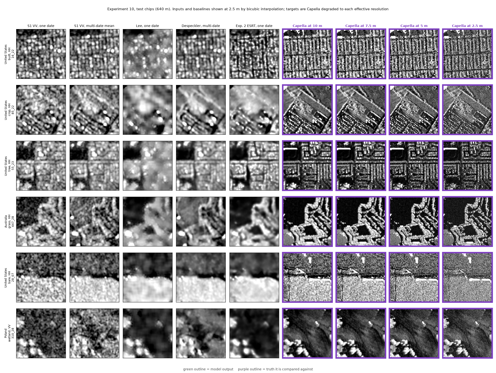

# Experiment 10, phase 1: dataset, baselines and ceilings

Status: planned. Phase 1 ran on the CPU on 2026-10-31. No model exists yet.

## Result

The dataset holds 5,417 accepted chips from 259 sites in 118 countries. Each chip pairs a 640 m Sentinel-1 input
with Capella targets degraded to 2.5, 5, 7.5 and 10 m. The baselines score low against every target. On test sites
at 5 m, the best baseline (the experiment 4 despeckler on the multi-date mean) reaches a structural similarity (SSIM)
of 0.072 and a high-pass correlation of 0.104. Two Capella images taken from the same orbit geometry reach 0.72 and 0.90. Two Capella images
taken from different geometries reach only 0.12 and 0.23. Sentinel-1 always views the ground from a different
geometry than Capella, so the second pair of numbers is the realistic ceiling. The pre-set rule asks the model for
+0.02 SSIM and +0.05 high-pass correlation over the best baseline. At 5 m that means closing about 40% of the gap to
the different-geometry ceiling on both metrics.

The reads came to 32.5 GB, under the 60 GB cap. The chips take 5.3 GB on disk.

## Dataset

| Split | Chips | Sites (one Capella item each) | Countries |
|---|---|---|---|
| Train | 3,753 | 184 | 102 |
| Validation | 777 | 36 | 20 |
| Test | 887 | 39 | 20 |

Every resolution uses the same chips; each chip stores all four targets. Splits follow 3° regional blocks. The 25
blocks that hold experiment 8's scenes went to test, so the linear-feature test runs on unseen ground.

- **Items.** `select_items.py` kept 270 of 2,285 Capella items: one per site, with WorldCover land ≥ 70%, at
  least half of the center flat, and a Sentinel-1 VV+VH pass within 6 days (all 270 met the 6-day preference).
  Built-dominated sites hit the 45% cap: 121 of 137 kept. 262 items produced chips. Four failed coarse alignment,
  and four had fewer than two passes for the multi-date mean.
- **Chips by cover (accepted).** Built 2,693, tree 964, grass 807, crop 573, bare 241, other 139. The test split
  holds 233 crop chips, the validation split only 40.
- **Polarization.** 5,188 chips are HH and 229 VV (val 71, test 29).
- **Mode.** spotlight 4,079, sliding spotlight 762, Stripmap 576.
- **Dates.** The median Sentinel-1 gap is 1.2 days, and 98.5% of chips lie within 6 days. The multi-date mean
  averages a median of 5 passes (2 to 11).

### Rejections

Of 10,011 candidate chips, 2,809 (28%) failed alignment and 1,785 (18%) had less than 80% valid pixels (water,
slope over 10°, no data). The table gives alignment rejects as a share of the chips with enough valid pixels.

| Cover | Alignment rejects |
|---|---|
| Built | 25% |
| Grass | 29% |
| Crop | 32% |
| Tree | 46% |
| Bare | 51% |
| Shrub | 54% |

By mode, alignment rejected 21% of sliding spotlight, 34% of spotlight and 47% of Stripmap chips. Rejected
chips mostly show low correlation at every shift (median best 0.06), which points to weak agreement between X-band
and C-band texture rather than a known misalignment. The baselines confirm this: on the rejected test chips the
best baseline scores SSIM 0.036 and high-pass correlation 0.031 at 5 m, a third of their score on accepted chips.
So the rule biases the dataset toward built and textured ground.

Accepted chips moved a median 21 m between Capella's stated position and Sentinel-1 (coarse plus fine shift),
in line with experiment 8.

### Target resolution

| Target R | Chain full width at half maximum (FWHM), median (worst item) | Nominal looks, median (10th percentile) | Speckle autocorrelation width, median |
|---|---|---|---|
| 2.5 m (stretch) | 2.5 m (5.9 m) | 11 (4) | 1.8 m |
| 5 m | 5.0 m (7.0 m) | 83 (28) | 6.0 m |
| 7.5 m | 7.5 m (8.9 m) | 190 (66) | 8.7 m |
| 10 m | 10.0 m (11.1 m) | 340 (120) | 11.1 m |

The chain FWHM combines Capella's native resolution, the overview pixel, the 1.25 m and 2.5 m grids and the added
Gaussian. Coarse Stripmap items can't reach the finer targets: their worst case sits at 7.0 m for a 5 m target. The
autocorrelation width is an upper bound because texture widens it. The build measures it before the last 2.5 m
mean, which explains the 1.8 m value at R = 2.5 m.

## Baselines and ceilings (test sites)

Scores are site medians of chip scores, on standardized dB. "Best" is the baseline chosen on validation sites.
The experiment 4 despeckler on the multi-date mean is best on SSIM and high-pass correlation at every resolution.

| R | Best SSIM | Best hp r | Best edge F1 | Same-geometry ceiling SSIM / hp r | Different-geometry ceiling SSIM / hp r | Model must reach SSIM / hp r |
|---|---|---|---|---|---|---|
| 2.5 m | 0.041 | 0.069 | 0.386 | 0.60 / 0.79 | 0.078 / 0.139 | 0.061 / 0.119 |
| 5 m | 0.072 | 0.104 | 0.392 | 0.72 / 0.90 | 0.122 / 0.233 | 0.092 / 0.154 |
| 7.5 m | 0.098 | 0.134 | 0.386 | 0.76 / 0.92 | 0.163 / 0.304 | 0.118 / 0.184 |
| 10 m | 0.123 | 0.166 | 0.402 | 0.78 / 0.93 | 0.181 / 0.346 | 0.143 / 0.216 |

- The multi-date mean beats the single date at every resolution. Its high-pass correlation with the target is
  0.097 at 5 m against 0.071 for one date. The despeckler adds a little on top (0.104).
- Experiment 2's ESRT model has the best edge F1 at 2.5 and 5 m but trails on SSIM and high-pass correlation.
- With shuffled inputs, the baselines fall to SSIM 0.02–0.03 and high-pass correlation 0.00. The model's shuffled
  check gets compared with that floor.
- Flat-area detail ratios: every baseline except single-date bicubic stays below 1, so the baselines add no
  detail in flat areas. Single-date bicubic reaches 1.2 at 10 m because it keeps speckle.
- **Ceilings.** The same-geometry ceiling uses 60 Capella repeat pairs at 34 sites from experiment 7 (599 chips).
  The different-geometry ceiling uses 37 pairs at 34 other sites taken 0.5–12 days apart from opposite orbit
  directions or incidence differing by 10° or more (325 chips). Its 2.5 m detail correlation, 0.12, matches
  experiment 1's 0.09. Geometry, not speckle, limits what any model can match.
- Full tables: `baselines_summary.csv`, `ceiling_summary.csv`, `ceiling_summary_cross.csv`; the rejected-chip
  check is in `baselines_summary_rej.csv`.

### Linear-feature test (experiment 8's 803 segments)

| Output | Detected |
|---|---|
| Single-date VV, bicubic to 2.5 m | 25% |
| Multi-date mean VV, bicubic | 34% |
| Despeckler on the multi-date mean | 42% |
| Capella degraded to 5 m / 10 m | 79% / 75% |

This code rebuilds segments as straight lines and doesn't mask crossings. On experiment 8's own 10 m multi-date VV
it detects 36% against experiment 8's 39%, with 88% agreement per segment. Compare models with these rows, not with
experiment 8's table.

## GPU plan

`run_queue.sh` lists the runs. Each starts only inside a coordinator slot, one at a time, and holds
`gpu_secondary.lock`.

| Stage | Runs | Expected | Budget |
|---|---|---|---|
| 1 | ESRT at R = 10, 7.5 and 5 m, seed 0 | 2.7 h | 3.6 h |
| Stretch | R = 2.5 m, only if 5 m passes | 0.9 h | 1.2 h |
| Seeds | Seeds 1 and 2 at the winning R and the next coarser one | 3.6 h | 4.8 h |
| Total | 8 runs | 7.2 h | 9.6 h |

The estimate scales experiment 2's measured 0.165 s per step by this model's CPU step cost, 1.21 times
experiment 2's, for 12,000 steps plus validation. Check the step time after 500 steps. `train.py` passed CPU smoke
tests: a few steps, resume from `_last.pt`, the CNN fallback, and a 200-step run on 30 chips whose training SSIM
rose from 0.02 to about 0.6. Evaluation (`eval.py`) runs on the CPU and applies the decision rule, the shuffled
input check and the feature test.

## Risks

- **Band and polarization.** 96% of targets are X-band HH, the inputs C-band VV and VH. The model must learn a
  band translation as well as sharpening. VV targets are too few (29 test chips) to test separately with power.
- **Geometry.** The different-geometry ceiling is low (high-pass correlation 0.23 at 5 m) because layover and
  shadow of buildings and trees move with the viewing direction. Sentinel-1 can't tell the model where Capella's
  layover falls. A model that beats the baselines may still fall far short of a sharp image.
- **Selection bias.** Alignment rejection removes half of bare and shrub chips and favors built ground. Results
  will hold for textured land. The rejected-chip scores show how much harder the rest is.
- **Speckle and texture.** At 2.5 m the targets keep 4–11 looks, so a model trained there learns to predict
  speckle-like texture. The decision rule's flat-area and shuffle checks exist to catch that.
- **Date gaps.** Gaps are short (median 1.2 days), so change matters less than geometry, but harvests and
  flooding can still differ.
- **Uneven splits.** Test holds most crop chips (because experiment 8's farmland scenes went there); validation
  holds most bare and wetland chips. Model selection on validation may not suit test cover.
- **Coarse-alignment outliers.** 26 items (121 chips, 102 in train) had too few well-correlated chips to check
  their fine shift. Some of them came with large coarse shifts (one of 1.8 km, z = 7.8) that are likely false
  matches. `chips.csv` flags them (`item_fine_verified`); training keeps them per the design, but a run without
  them is a cheap check.
- **Disk.** Free space on E: fell from 226 GB to about 170 GB during the session, mostly from other work. This
  experiment uses 5.3 GB.

## Files

`DESIGN.md` (pre-set rules, amendments 1–3), `select_items.py`, `build_chips.py`, `make_splits.py`, `common.py`,
`baselines.py`, `ceiling.py`, `feature_test.py`, `dataset_stats.py`, `panels.py`, `train.py`, `eval.py`,
`run_queue.sh`. Tables: `items.csv`, `items_built.csv`, `chips.csv`, `chips_all.csv`, `splits.csv`,
`dataset_stats.json`, the baseline, ceiling and feature CSVs. Chips: `data/chips/` (gitignored).
