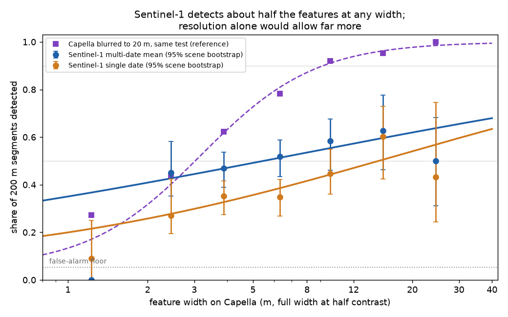
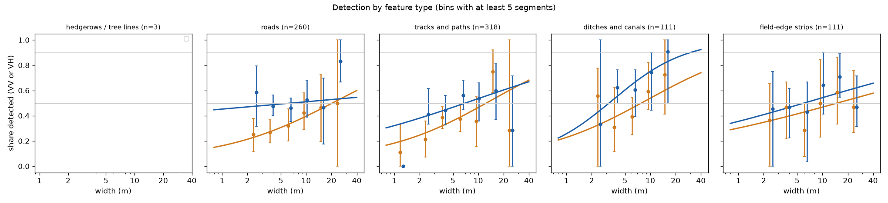
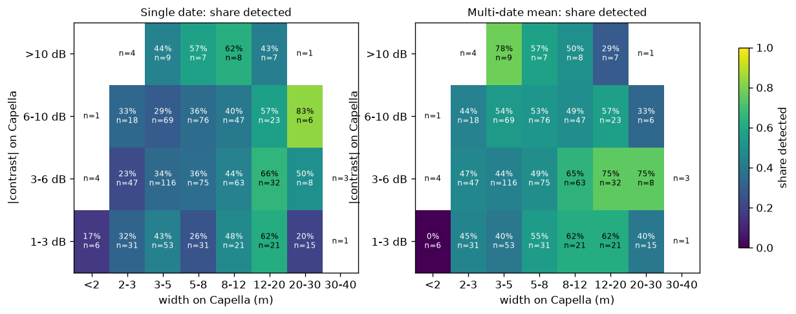
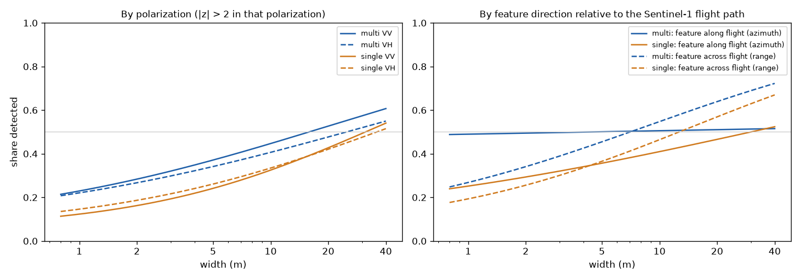

# Experiment 8 results: how narrow a linear feature can Sentinel-1 show?

Status: done (2026-10-28). CPU only.

## Result

Width alone doesn't decide whether Sentinel-1 shows a linear feature. Each test segment is a 200 m
stretch of feature that Capella shows clearly. With a multi-date mean of Sentinel-1 VV and VH, the pre-set
test detected about half of these segments at almost any width: 45% of features 2–3 m wide, 52% at 5–8 m
and 63% at 12–20 m. A single date detected fewer, rising from 27% at 2–3 m to 60% at 12–20 m. Neither curve
reaches 90% within the measured range of 1 to 40 m.

| Sentinel-1 product | Segments | Detected | Width at 50% detection | Width at 90% detection |
|---|---|---|---|---|
| Multi-date mean, VV or VH | 803 | 51% | 5.5 m (2.8–15.7) | beyond 40 m |
| Single date, VV or VH | 803 | 38% | 14.9 m (9.0 to beyond 40) | beyond 40 m |
| Multi-date mean, VV only | 803 | 39% | 15.9 m (8.9 to beyond 40) | beyond 40 m |
| Multi-date mean, VH only | 803 | 36% | 24.9 m (12.1 to beyond 40) | beyond 40 m |
| Reference: Capella blurred to 20 m | 803 | 74% | 3.0 m (2.6–3.5) | 9.2 m (7.3–12.5) |

Widths come from a logistic curve whose floor is the measured false-alarm rate (5.0–5.6%). Ranges in
parentheses are 95% intervals from 1,000 bootstrap draws of scenes (500 for the reference).

The reference row explains the gap. The same test, applied to Capella's own profile after blurring it to
about the 20 m Sentinel-1 resolution, detects 92% of features 8–12 m wide and all features wider than 20 m. Resolution
alone would therefore let a 10 m sensor show most features wider than about 9 m. Sentinel-1 misses many of
them because its C-band VV and VH contrast differs from Capella's X-band HH contrast. Fields on either side
often look the same at C-band, a road or ditch gives little contrast, and speckle hides weak contrast.

### By feature type, multi-date mean

| Type | Segments (scenes) | Median width | Detected | Width at 50% | Width at 90% |
|---|---|---|---|---|---|
| Ditches and canals | 111 (15) | 6.3 m | 65% | 3.2 m (0.8–5.5) | 29.8 m (13.2 to beyond 40) |
| Field-edge strips | 111 (15) | 7.5 m | 52% | 6.0 m (1.4–33.2) | beyond 40 m |
| Roads | 260 (21) | 6.5 m | 50% | 6.6 m (0.1 to beyond 40) | beyond 40 m |
| Tracks and paths | 318 (19) | 4.5 m | 47% | 7.0 m (1.7 to beyond 40) | beyond 40 m |
| Hedgerows and tree lines | 3 (2) | 4.2 m | 0 of 3 | too few | too few |

Ditches and canals are the one type with a clear width curve. Dark ditches (82 segments) reach 50% at
4.4 m (2.0–5.9) and 90% at 11.4 m (8.1–21.0) in the multi-date mean. Single dates give
7.8 m and beyond 40 m for all ditches. Roads, tracks and field-edge strips stay near 45–60% across widths.
For roads the single-date curve rises from 25% at 2–3 m to about 50% above 12 m, while the multi-date mean
sits near 50% throughout. Hedgerows didn't yield a usable sample (see the limits).

### Contrast, brightness, polarization and direction

- **Capella contrast barely matters.** In a fit with both log width and |contrast|, a 1 dB rise in
  X-band contrast raises the odds of detection by only 2% (multi-date) or 0.5% (single date). The width at
  50% moves from 6.4 m at 2 dB contrast to 3.9 m at 12 dB. A bright 3 m road and a dark 3 m ditch differ less
  at C-band than their X-band contrast suggests. The width-by-contrast grid shows no consistent gradient
  along the contrast axis.
- **Bright features do better on single dates.** Features that are bright on Capella reach 50% at 6.2 m
  (4.0–19.4) on a single date, dark ones at 26 m. In the multi-date mean the difference shrinks (3.9 m
  against 6.6 m).
- **Two polarizations beat one.** VV alone or VH alone detects 36–39% in the multi-date mean. Allowing either
  one, with a stricter threshold that keeps the false-alarm rate at 5.4%, detects 51%.
- **Direction relative to the flight path makes little difference.** Features within 30° of the flight
  direction and features more than 60° from it reach 50% at 4.4 m and 7.0 m in the multi-date mean, with
  overlapping intervals.
- **The sign often agrees.** Among detected segments, the Sentinel-1 contrast has the same sign as Capella's
  in 74% of VV detections and 66–69% of VH detections.

## What "detected" means here

The test asks whether Sentinel-1 shows any contrast at a known 200 m line, averaged along the whole line,
compared with parallel lines 40–75 m away. That is a lenient test. It knows where to look, and averaging
along 20 pixels removes most speckle. A field-boundary mapper sees one pixel at a time and doesn't know the
line's position, so it needs more contrast. Read these curves as an upper bound on what a 10 m map can
recover.

The test also responds to anything along the line, not only to the measured feature. A 2 m track usually
runs with a verge, a crop change or a ditch beside it. The spot-check panels show cases where Sentinel-1
gives a broad 1 dB step across a narrow, bright Capella road. That is why narrow features score near 45%
in the multi-date mean: often the corridor is detected, not the track. This matters less for field-boundary
mapping, where the corridor is the boundary, but it means the curve doesn't measure a resolution limit.

## Method

**Scenes.** From experiment 6's 190 Capella items over cropland with a matched Sentinel-1 pass, one item
per site (finest resolution, then the closest pass in time). A 4 km window went where rural OSM lines were
densest. That gave 30 scenes in 18 countries after the cap of 4 per country (`scenes_selected.csv`,
`windows.geojson`). Eight scenes failed the alignment check below. The headline uses the other 22 scenes in
14 countries: Poland, Spain, the United States, Germany, Myanmar, the United Kingdom, Austria, Australia,
Taiwan, the Netherlands, Russia, Georgia, Italy and Moldova. All but two Capella items are HH.

**Lines.** OpenStreetMap lines via Overture Maps (release 2026-10-21.0), because the public Overpass
servers were at capacity. Roads, tracks and paths, ditches, drains and canals, hedges, tree rows and outlines
of farmland, meadow, orchard and vineyard. A field-edge strip is a land-use outline with no other mapped
line within 30 m. Lines were cut into 200 m segments. Segments with a parallel mapped line within 30 m, or
with crossings along more than 40% of their length, were dropped.

**Width on Capella.** Capella GEO amplitude averaged to 1 m. Perpendicular profiles every 1 m along each
segment, averaged in ten 20 m blocks. The blocks were aligned to each other by up to ±4 m and averaged
again. Width is the full width at half contrast against the mean of the two background levels. A segment
counts as a clear feature only with Capella matched-null |z| ≥ 4, |contrast| ≥ 1 dB, similar backgrounds on
both sides (not a step between two fields), and the extremum in at least 6 of 10 blocks. Of 11,700 segments
in the 22 scenes, 4,900 had parallel neighbors, 1,100 too many crossings and 1,100 no Capella data, and
3,400 showed no clear feature. 803 passed.

**Sentinel-1.** Planetary Computer RTC (terrain-corrected gamma0, 10 m, VV and VH). Single date: the pass
nearest Capella, a median 0.6 days away (all within 10 days). Multi-date mean: every pass from that
track within ±30 days, typically 4–5 dates and up to 10. No speckle filter.

**Detection rule (set before measuring).** At the Capella-measured center, contrast is the mean of the
center window, |d| ≤ max(5 m, width / 2), against the two 15 m flanks. The null is the same statistic on 16
parallel lines placed so that their windows stay 10 m clear of the feature. Detected when |z| > 2 in one
polarization, or > 2.24 in VV or in VH for the headline. The false-alarm rate comes from applying the rule
to each null line against the other 15.

**Alignment.** Capella GEO sat up to 270 m from its true position (site 299, hilly Austria) and 10–40 m off
elsewhere. A coarse shift comes from cross-correlating Capella at 10 m with the multi-date VV over ±1.5 km.
Correlation leans on trees and buildings, whose layover differs between X-band and C-band. A second step
therefore fits the Capella centers of roads, tracks and ditches to the OSM lines and shifts Capella by that
offset (median residual scatter 4.9 m). Scenes with fewer than 8 such ground features couldn't be checked
and leave the headline.

**Changes to the plan.** `DESIGN.md` records three amendments and one code fix, all made before any
Sentinel-1 result was looked at. They cover the Overture source and rural window placement, the two-step
alignment and the ground-feature shift. The code fix repaired a block-alignment bug that had shifted every
center by 4 m. One check came after seeing results. The pre-set contrast mixes a linear mean (center) with a
dB mean (flanks), which can turn a plain step between two fields into a positive contrast.
`rescore.py` recomputes everything with all three windows averaged in dB. Detection stayed at 51%
(multi-date) and 38–39% (single date), and the width at 50% stayed at 5.5 m (2.9–13.8) and 14.8 m
(`width_table_db.csv`, `figures/*_db.png`). Including the 8 unchecked scenes (868 segments) gives 5.3 m
and 13.5 m.

## Limits

- **OSM position.** OSM lines can be off by several meters, and some mapped features don't exist on the
  ground. The ±15 m search and the clear-feature rule remove those, so the sample favors well-mapped,
  high-contrast features. After alignment, Capella centers scatter 2–9 m around the OSM lines per scene.
  Residual misregistration of a few meters weakens the center window for narrow features at 10 m pixels.
- **HH against VV.** 20 of the 22 Capella scenes are HH, at X-band. Sentinel-1 is VV and VH at C-band.
  The contrast that makes a feature clear on Capella need not exist at C-band, which the gap to the
  blurred-Capella reference shows.
- **Look direction and incidence.** The flight direction comes from an orbit approximation. X-band
  layover shifts tall features toward the sensor, so the Capella center of a hedge or tree line isn't
  where Sentinel-1 sees it. That helps explain why tree lines failed. Only 23 tree lines passed the Capella
  checks, mostly in UK site 239. That scene had too few ground features to check, so 3 remain in the
  headline. This experiment says nothing reliable about hedgerows.
- **Speckle.** Single dates detect 10–20 points less than the multi-date mean at most widths. Five dates
  aren't a full seasonal composite either.
- **Width resolution.** Capella Stripmap and Sliding Spotlight resolve about 1 m. Only 11 features measured
  under 2 m, so the curve below 2 m isn't measured.
- **Widest features.** Only 34 segments are wider than 20 m. The dip at 20–40 m rests on few segments, and
  some wide features are canals or roads whose flanks reach other structures.
- **Lenient test.** Known position and 200 m averaging make detection easier than per-pixel mapping.

## Spot check

`spotcheck/` holds 60 panels from the headline scenes, stratified by type, width class and multi-date
outcome (30 detected, 30 not). Each shows Capella at 1 m (purple outline, the truth), Sentinel-1 VV single
date, VV and VH multi-date means (no outline; no detector output is drawn) and the across-line profiles.
`spotcheck.csv` lists them with an empty `verdict` column.

### Human verdicts (2026-10-30)

One reviewer judged all 60 panels.

- **Capella truth holds:** 45 of the 49 decided panels show a real linear feature on Capella; 4 show none.
- **The detector mostly agrees with the reviewer.** Where the multi-date test said "detected", the reviewer saw the feature on Sentinel-1 in 19 of 25 decided panels. Where it said "not detected", the reviewer agreed in 13 of 20. Overall agreement is 32 of 45 (71%).
- **The test misses some visible features.** Seven panels the test scored as not detected were visible to the reviewer, so the automatic rule is a little strict, not lenient, on these panels.
- **VH looked clearer than the automatic numbers suggest.** Of 23 reviewer notes, 13 favor the VH multi-date mean, 5 favor the VV multi-date mean and 3 name both. The automatic test puts VH alone at 24.9 m for 50% detection, worse than VV. The profile test may undervalue VH contrast, so the polarization split deserves a second look.
- Two tree-line panels were unsure, and one road looked brighter on Sentinel-1 than on Capella, possibly a structure under canopy.

## Files

Scripts: `select_scenes.py`, `measure.py`, `analyze.py` (set `EXP8_VARIANT=db` for the dB variant),
`rescore.py`, `blur_reference.py`, `figure_reference.py`, `spotcheck.py`. Tables: `scenes_selected.csv`,
`scene_meta.csv`, `segments_all.csv`, `segment_status.csv`, `curve_bins.csv`, `width_table.csv`,
`width_contrast_grid.csv`, `summary.json`, `blur_reference.csv`, plus `_db` versions. Figures in `figures/`.
Data in `data/` (0.7 GB, gitignored). Downloads were about 2.9 GB per full run (Capella tiles 2.4 GB,
Sentinel-1 0.5 GB). Pilots and three reruns bring the total to about 10 GB, plus unmetered Overture range
reads.
